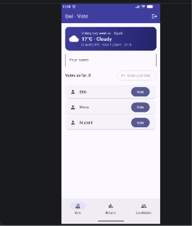
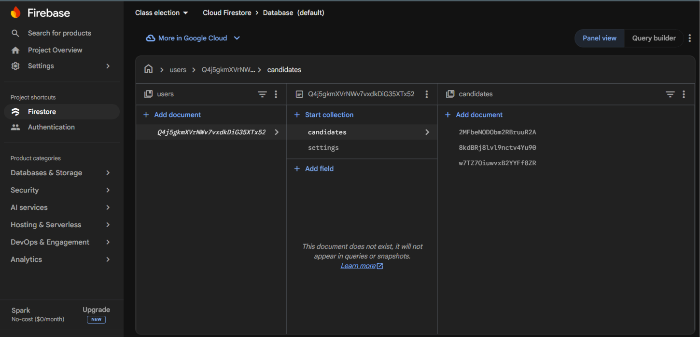
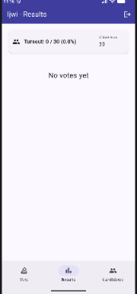
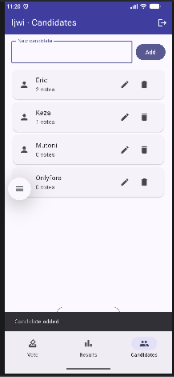

# Ijwi (Class Election)

Ijwi is a class election app where students vote for a representative and see the live results. It signs users in with Firebase Authentication, and each user's data is saved in Cloud Firestore under their own id, so two accounts never see each other's data, and every change appears live.

## Screenshots

### 1. Login

### 2. My data in Firestore

### 3. Live update
Before the change in the console:

After the change, without restarting the app:

### 4. Privacy between accounts
First account:

Second account sees nothing of the first account's data:

